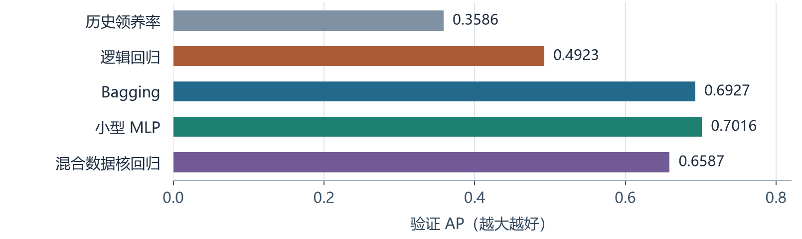
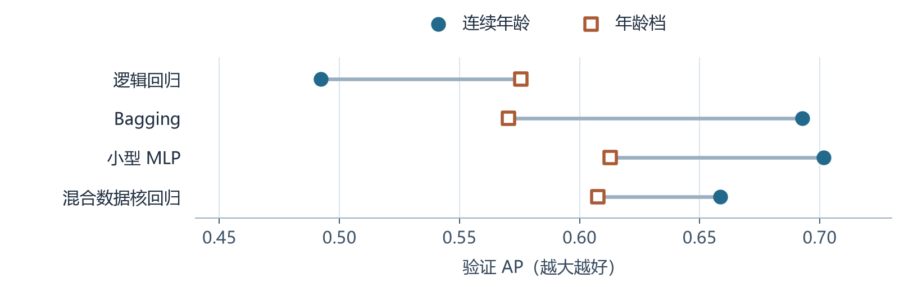
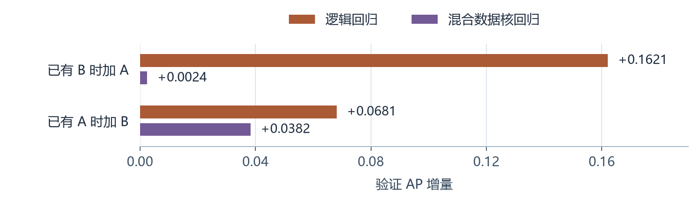
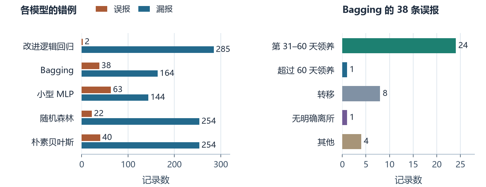

# DSC5001 奥斯汀收容所领养预测实验报告

组内交流 · 2026 年 11 月 16 日

## 1 研究问题与数据准备

我们用猫狗**刚进入奥斯汀动物收容所时**能知道的信息，估计这次入所后 **30 天内被该收容所登记为正式领养**的概率。每条样本代表一次入所。研究使用 2022–2024 年入所记录，既比较模型表现，也检查年龄表示、入所背景和判定阈值如何影响结果。

在相同的五项输入下，Bagging 和小型 MLP 的留出 AP 接近。年龄分档改善了逻辑回归的表现。Bagging、MLP 和核回归使用具体年龄时的 AP 更高。幼猫的漏报集中在 4 至不足 8 周龄，部分误报涉及第 30 天以后才领养的记录。核回归的三阶段对照当前已有验证结果。

### 从两张表还原一次入所经历

奥斯汀市开放数据的历史归档包含 **173,812 条入所记录**和 **173,775 条离所记录**。入所表提供物种、年龄、性别及绝育状态、入所原因和入所状况。离所表提供离所日期与去向。2022–2024 年有 33,100 条原始猫狗入所记录，整理后得到 33,089 次入所事件，其中 32,912 次能唯一确定首条对应离所记录。［1–2］

1. **按编号和时间配对。** 根据动物编号、物种和时间查找本次入所后的离所记录，下一次入所划定本次经历的边界。同一动物多次入所时，每次经历分别配对。
2. **复核重复和冲突。** 合并任务字段一致的重复记录。标记同日归属不清、登记冲突或去向缺失等情况，并据此判断标签能否确定。
3. **根据去向和日期打标签。** 入所当天算第 0 天，首个明确归属的离所去向为 Adoption，且发生在第 0 至 30 天，就记为 1。观察窗口完整且时序清楚、未找到离所候选的记录，按「窗口内无本中心领养记录」记为 0 并保留标记。有明确去向的记录也单独做了复核。

**表 1 同一次入所如何生成两个观察窗口的标签**

| 观察到的结局 | 30 天标签 | 60 天标签 |
|---|---:|---:|
| 第 20 天登记为正式领养 | 1 | 1 |
| 第 35 天登记为正式领养 | 0 | 1 |
| 第 8 天转移到合作机构 | 0 | 0 |
| 只观察 18 天，结局仍不明确 | 未知 | 未知 |

动物编号和日期用来配对和划分样本，离所去向和日期用来生成标签。预测输入取自入所登记的五项字段。

<!-- pagebreak -->

## 2 时间划分与评价方法

用较早入所的样本训练，再用之后入所的样本验证和测试。验证集排除训练期出现过的动物。测试集排除训练或验证期出现过的动物。同一动物在一个集合里的不同入所经历可以保留。

**表 2 三个数据集合及 30 天领养标签分布**

| 集合 | 入所日期范围 | 可用记录 | 30 天领养 | 正例比例 |
|---|---|---:|---:|---:|
| 训练 | 2022 年 1 月至 2023 年 10 月 | 20,454 | 7,290 | 35.6% |
| 验证 | 2024 年 1 月至 6 月 | 5,878 | 2,108 | 35.9% |
| 留出测试 | 2024 年 9 月至 12 月 | 3,352 | 1,327 | 39.6% |

2023 年 11–12 月和 2024 年 7–8 月用于留足随访时间。归档中的离所记录覆盖至 2025 年 5 月 5 日，可补齐年底入所样本的 60 天观察窗。训练集用于拟合模型。验证集用于检查模型设定与确定分类阈值。已完成的留出测试使用验证阶段保存的模型与阈值。

### 输入如何处理

- **年龄。** 将天、周、月和年统一成年龄天数。连续年龄使用 log(1 + 年龄天数)。连续年龄缺失时，用训练集的中位数填补并保留缺失标记。年龄档分为未满 3 个月、3 至不足 6 个月、6 至不足 12 个月、1 至不足 7 岁、7 岁及以上和未知。
- **类别字段。** 猫狗、性别及绝育状态、入所原因和入所状况按类别处理，性别及绝育状态保留为原来的一列。逻辑回归、树模型与 MLP 用类别指示列，核回归用类别是否一致计算相似度。猫狗放在同一套模型里训练，评估时按物种和年龄组查看。

### 预测概率如何评分

- **AP 越高越好。** 将测试记录按预测概率排序，衡量真实在 30 天内领养的记录能否排到前面。历史比例基准给每条记录同一个分数，其 AP 等于该评估集的实际正例比例。
- **Brier 越低越好。** 对每条记录，计算预测概率和实际标签 0 或 1 的平方差，再取平均。这个指标用来比较概率误差。
- **误报和漏报需要定阈值。** 以 0.50 为共同参照。另外，为各模型选取能在验证集找回至少 70% 正例的最高阈值。将该阈值用于测试，观察实际召回和误报。
- **比较分差的不确定性。** 主要 AP 差值使用 1,000 次配对自助抽样，按动物编号重抽，两种模型使用同一批抽样动物。95% 区间反映该评估样本下的波动，时段差异另行检查。

<!-- pagebreak -->

## 3 第一阶段 统一输入比较模型

给各学习方法相同的五项原始信息，**物种、连续年龄、性别及绝育状态、入所原因、入所状况**。这套输入也就是第三阶段的「基础 + B」。历史领养率基准给所有记录相同的 35.6%。

- **逻辑回归**学习各字段对领养概率的权重。**Bagging** 对训练数据重复抽样，训练 350 棵树后对各树的概率取平均。
- **小型 MLP** 用一层 16 个隐藏单元学习非线性的字段组合。主表使用预定的随机种子，其他种子用于检查稳定性。
- **混合数据核回归**直接估计相似历史记录的加权领养率。年龄越接近、类别字段匹配越多，权重越高。试跑固定对数年龄带宽为 0.35，分类字段每不匹配一项，权重乘 0.35。［3］

**表 3 相同五项输入下的验证和留出测试成绩**

| 方法 | 验证 AP | 验证 Brier | 留出 AP | 留出 Brier |
|---|---:|---:|---:|---:|
| 历史领养率 | 0.3586 | 0.2300 | 0.3959 | 0.2407 |
| 逻辑回归 | 0.4923 | 0.2022 | 0.5105 | 0.2183 |
| Bagging | 0.6927 | 0.1701 | 0.7002 | 0.1768 |
| 小型 MLP | 0.7016 | 0.1661 | 0.6947 | 0.1774 |
| 混合数据核回归 | 0.6587 | 0.1854 | 待评估 | 待评估 |

**图 1 统一使用连续年龄并包含入所背景时的验证 AP**

MLP 验证 AP 略高，Bagging 留出 AP 略高。留出集上以 MLP 减 Bagging，差值为 **-0.0055**，95% 区间为 **[-0.0185, 0.0083]**。两个方法在总体排序和概率误差上都接近。

<!-- pagebreak -->

## 4 第二阶段 替换年龄表示

对同一个模型，比较**只用连续年龄**和**只用年龄档**两种给法。两种配置都保留物种、性别及绝育状态、入所原因和入所状况，使用同一批验证记录。这样可以把分数变化对应到年龄表示的替换。

**表 4 连续年龄替换为年龄档前后的验证 AP**

| 方法 | 连续年龄 | 年龄档 | 替换后 AP 变化 |
|---|---:|---:|---:|
| 逻辑回归 | 0.4923 | 0.5755 | +0.0832 |
| Bagging | 0.6927 | 0.5703 | -0.1224 |
| 小型 MLP | 0.7016 | 0.6128 | -0.0888 |
| 混合数据核回归 | 0.6587 | 0.6076 | -0.0510 |

**图 2 年龄分档对不同模型的影响方向**

在其他字段给定时，逻辑回归的单个连续年龄项只能使预测概率随年龄向一个方向变动。分档后，每个年龄阶段可以有自己的权重。在留出数据里，猫的实际 30 天领养率从未满 3 个月的 32.0% 升到 3 至不足 6 个月的 71.9%，1 至不足 7 岁为 36.5%。这些分组比例显示年龄关系可能先升后降。

Bagging 可以用具体年龄自行找分界点，MLP 可以学习非线性关系，核回归可以按年龄接近程度加权。把 4 周和 7 周的幼猫一起归入「未满 3 个月」时，具体年龄的差异就被合并。逻辑回归、Bagging 和 MLP 在留出集上的变化方向也和验证一致。

**保留具体年龄，再额外加入年龄档和物种交互，能给哪些模型带来增益？**

<!-- pagebreak -->

## 5 第三阶段 A 和 B 特征组消融

四格都使用同样的样本划分，在**物种、连续年龄、性别及绝育状态**三项基础输入上，逐组加入以下字段。

- **A 年龄表示组。** 额外加入年龄档和「物种 × 年龄档」，例如把「猫且未满 3 月龄」作为组合类别。A 使用原有的年龄和物种信息构造。
- **B 入所背景组。** 加入入所原因与入所状况两列。这两列分别编码，主消融里一起加入或移除。

**表 5 四格消融的验证 AP**

| 输入配置 | 逻辑回归 | Bagging | 小型 MLP | 核回归 |
|---|---:|---:|---:|---:|
| 基础 | 0.3677 | 待补 | 待补 | 0.6173 |
| 基础 + A | 0.5862 | 待补 | 待补 | 0.6229 |
| 基础 + B | 0.4923 | 0.6927 | 0.7016 | 0.6587 |
| 基础 + A + B | 0.6543 | 0.6935 | 待补 | 0.6611 |

**图 3 保留另一组时，加入 A 或 B 的验证 AP 变化**

固定 B 时，加 A 使逻辑回归的验证 AP 增加 **0.1621**，核回归增加 **0.0024**。固定 A 时，加 B 使两者分别增加约 **0.068** 和 **0.038**。另外两条比较可以检验，每组的增益是否会随另一组的加入而变化。

留出测试把逻辑回归的 A 组拆成两步。已有 B 时，连续年龄版 AP 为 **0.5105**，加年龄档后为 **0.6541**。再加物种交互达到 **0.6585**，这一步增加约 0.0043，95% 区间跨过 0。连续年龄的 Bagging 加 A 后，留出 AP 增加约 0.0002。

<!-- pagebreak -->

## 6 树模型组件对照与稳健性

单棵树、Bagging 和随机森林都使用第一阶段的五项字段。树的最大深度为 5，叶节点至少有 25 条训练记录。Bagging 和随机森林均用有放回抽样训练 350 棵树。Bagging 每次分裂可考察全部编码特征，随机森林在每次分裂时抽取一部分候选特征。

**表 6 逐步加入树集成组件时的模型表现**

| 方法 | 验证 AP | 留出 AP | 留出 Brier |
|---|---:|---:|---:|
| 单棵决策树 | 0.6559 | 0.6698 | 0.1796 |
| Bagging | 0.6927 | 0.7002 | 0.1768 |
| 随机森林 | 0.6708 | 0.6760 | 0.1975 |

Bagging 比单树的留出 AP 高 0.0305，95% 区间为 [0.0238, 0.0385]。在此基础上加入节点特征抽样，随机森林的留出 AP 相对 Bagging 下降 0.0243，95% 区间为 [-0.0435, -0.0071]。

Bagging 的 350 棵树都在首个分裂使用了连续年龄，随机森林中有 60 棵这样做。在本次浅树设定下，候选特征抽样可能减少树在前几层使用年龄的机会。

### 跨月份和数据质量复核

**表 7 同一个连续年龄 Bagging 在不同时间段的 AP**

| 所属集合 | 时段 | 实际 30 天领养率 | Bagging AP |
|---|---|---:|---:|
| 验证 | 2024 年 1–3 月 | 43.6% | 0.7469 |
| 验证 | 2024 年 4–6 月 | 30.8% | 0.6494 |
| 留出测试 | 2024 年 9–10 月 | 39.0% | 0.7251 |
| 留出测试 | 2024 年 11–12 月 | 40.3% | 0.6692 |

不同时间段的 AP 会受到排序表现和真实领养比例的共同影响，因此表里同时列出两项。

仅用能配到明确离所且去向有记载的 **3,279 条**留出记录复核，Bagging 和 MLP 的 AP 分别为 0.7044 和 0.6989。连续年龄 MLP 换三个随机种子，留出 AP 在 0.6947 至 0.6983 之间。

### 年龄档版本的统计补充

早期的分类朴素贝叶斯使用年龄档，在留出集上的 AP 是 0.6244。在未按期领养的训练记录中，「未满 3 月龄」与「登记为新生」同时出现 730 条，按条件独立假设计算约为 311 条。这两个字段在给定领养结局后仍相关，模型可能把部分重叠的信息算成两份。

<!-- pagebreak -->

## 7 错例分析 幼猫漏报集中在哪里

3,352 条留出记录中，有 **941 条未满 3 月龄的猫**，其中 301 条在 30 天内领养。按 0.50 阈值，Bagging 找回 137 条、误报 38 条、漏报 164 条。MLP 找回 157 条、误报 63 条、漏报 144 条。两者总体 AP 接近，具体的误报与漏报取舍有差别。

**图 4 幼猫在 0.50 阈值下的错例及 Bagging 误报去向**

图中改进逻辑回归使用「基础 + A + B」，朴素贝叶斯用年龄档。Bagging、MLP 和随机森林用连续年龄五项输入。

### 为什么会漏报

Bagging 漏报的 164 条中，有 **158 条来自 4 至不足 8 周龄**。该组共 464 条记录，真实 30 天领养率为 34.1%，模型给出的平均预测概率是 33.3%，最高只有 46.1%。所以 0.50 阈值下，这一组的 158 条正例都低于阈值。使用验证期定出的 0.3795 阈值，该组找回 146 条正例，同时产生 187 条误报。

### 为什么会误报

Bagging 的 38 条误报中，有 **24 条在第 31–60 天被领养**，另有 8 条被转移。这些真实去向帮助我们判断，哪些错例与 30 天期限有关。下表给出两条原始输入相同的留出记录。

**表 8 同样入所信息在 30 天期限两侧的案例**

| 入所登记 | Bagging 概率 | 实际领养时间 | 30 天标签 |
|---|---:|---|---:|
| 1 月龄、未绝育公猫、流浪、正常 | 41.7% | 第 20 天 | 1 |
| 1 月龄、未绝育公猫、流浪、正常 | 41.7% | 第 35 天 | 0 |

另一个模型分歧案例是一只 2 月龄、登记状况为 Medical 的流浪雌猫。MLP 给出 80.4%，Bagging 给出 26.6%，实际在第 3 天被原主人领回。

<!-- pagebreak -->

## 8 延长观察窗口与当前进度

取 30 天和 60 天标签都能确定的同一批样本，沿用原有划分和输入，分别按两个目标训练。两次测试使用相同的 3,352 条入所记录，其中有 941 条幼猫记录。

**表 9 相同幼猫记录上两个窗口的 Bagging 结果**

| 观察窗口 | 正例数 | 正例比例 | AP | Brier | 误报 | 漏报 |
|---|---:|---:|---:|---:|---:|---:|
| 30 天 | 301 | 32.0% | 0.6843 | 0.1346 | 38 | 164 |
| 60 天 | 548 | 58.2% | 0.8488 | 0.1407 | 92 | 75 |

误报和漏报统一用 0.50 阈值。窗口变长后，247 条幼猫记录被重新计为按期领养。两项任务的正例比例不同，AP 各自与同一窗口的基准比较。这个实验直接量化了领养时间超过第 30 天对标签和错例的影响。

### 写作与实验进度

- **已有结果。** 第一阶段的连续年龄比较和第二阶段的年龄替换都已有共同验证成绩。逻辑回归四格已有验证与留出测试，核回归四格已有验证结果。树模型组件对照、幼猫错例及 60 天敏感性分析已完成。
- **第三阶段还有待补项。** 若对主要模型都给出完整四格，Bagging 要补「基础」和「基础 + A」，MLP 要补「基础」「基础 + A」「基础 + A + B」。核回归的正式留出成绩待评估。
- **补充结果。** 品种和毛色已做早期试跑，可在主结果汇报后另议。侧会话记录了拆分入所原因与状况、拆分性别与绝育状态的验证结果。组内备忘保存了数值，纳入正式表之前需核对其可复现记录。
- **报告的主线。** 按「五项统一输入比较 → 替换年龄表示 → 固定连续年龄做四格」组织实验与结果，再接树模型组件差异和幼猫错例。选择最终输入配置时以验证结果为依据，留出成绩用于评估设置确定后的表现。

### 数据来源与复现材料

- ［1］奥斯汀市开放数据历史归档 [Animal Center Intakes](https://data.austintexas.gov/d/wter-evkm)。
- ［2］奥斯汀市开放数据历史归档 [Animal Center Outcomes](https://data.austintexas.gov/d/9t4d-g238)。
- ［3］Racine 和 Li，2004，[连续与类别数据的非参数核回归](https://doi.org/10.1016/S0304-4076(03)00157-X)。
- 项目内可复查正式数据准备和实验脚本、训练验证测试样本数及数据质检表、正式验证和测试的逐条预测与指标、混合数据核回归的试跑脚本和结果表。
